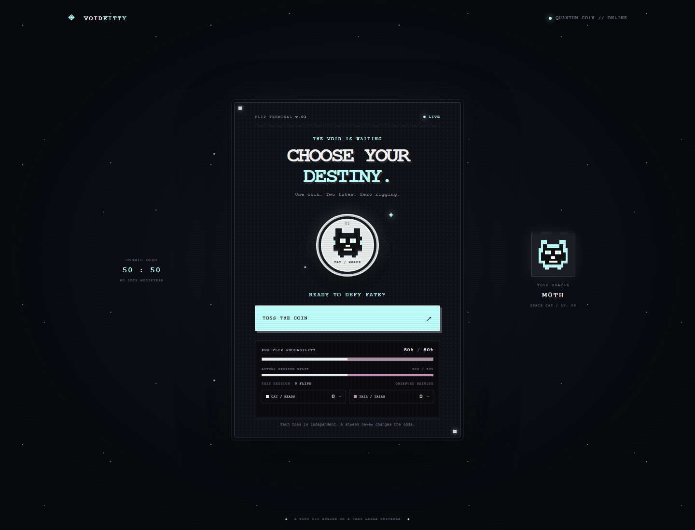
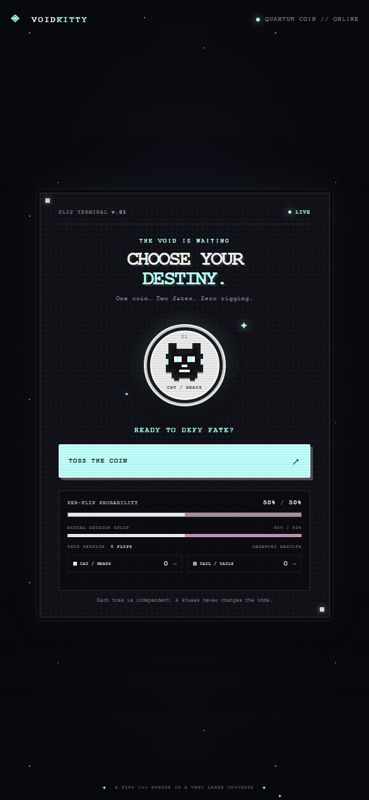

# VOIDKITTY — C++ Coin Flip

> One coin. Two fates. Zero rigging.

VOIDKITTY is a tiny, local coin-flip app with a compiled C++ backend and a TypeScript frontend. The backend serves the site and chooses each outcome. The browser animates a pixel-art space cat for heads and a curled tail for tails, then tracks the outcomes you have seen in this tab.

## Interface





The toss animation and result-driven colors are interactive; the screenshots show the ready state at desktop and mobile sizes.

## Quick start on Windows

1. Install Node.js 20 or newer and Visual Studio C++ Build Tools (the **Desktop development with C++** workload), or another C++17 compiler.
2. Double-click [`Start Coin Flip.bat`](./Start%20Coin%20Flip.bat).
3. The script installs dependencies if needed, compiles the C++ app, starts it, and opens `http://localhost:3000`.
4. Keep the server console window open while using the app. Close that window to stop it.

The C++ compiler must be installed. If `cl.exe` is not on `PATH`, the build helper locates Visual Studio using `vswhere` and initializes its compiler environment.

## Manual commands

```powershell
npm install
npm run build
npm start
```

Then visit `http://localhost:3000`. For frontend development with Vite's hot reload:

```powershell
npm run dev
```

Vite runs the TypeScript frontend on `http://localhost:5173` and proxies `/api/flip` to the compiled C++ server on port 3000.

## How the odds work

Every request to the C++ engine makes a fresh, independent choice between `heads` and `tails`. The C++ code seeds a persistent `std::mt19937_64` engine with values from `std::random_device`, then asks `std::uniform_int_distribution<int>(0, 1)` for one of its two equiprobable outcomes. The intended probability on each toss is **50% heads and 50% tails**.

The app's fixed 50/50 bar represents the probability of the *next individual toss*. The separate session split is only a count of the outcomes observed in this browser tab; it does not predict or influence the next result. For example, four tails in a row do not make heads “due”—the next toss is still 50/50.

“50/50” describes the chance of either result on each toss, not a promise that every small batch will contain exactly equal numbers of both. Random sequences can have streaks and uneven short-term counts. `std::mt19937_64` is a deterministic pseudorandom engine after it is seeded, and the quality of `std::random_device` entropy depends on the platform. This app is for casual decisions, not cryptographic or regulated randomness.

## Why C++ and TypeScript?

- **C++17 owns the outcome and HTTP server.** It compiles to a native executable, serves the built website, and is the only component that chooses heads or tails. That makes the randomness path explicit and keeps the UI from inventing results.
- **TypeScript owns the browser experience.** It builds the page, starts and finishes the animation, validates the response, updates the session display, and handles errors. Types make the two possible outcomes visible in the frontend code.
- **Vite is the frontend build/dev tool.** It bundles TypeScript and CSS; it is not part of the coin-flip decision.

## Project map

| Path | Purpose |
|---|---|
| [`cpp/flip.cpp`](./cpp/flip.cpp) | C++ HTTP server, random engine, and `/api/flip` endpoint |
| [`src/main.ts`](./src/main.ts) | Landing page markup, coin animation flow, and session statistics |
| [`src/style.css`](./src/style.css) | Pixel-art terminal visuals, responsive layout, and animations |
| [`scripts/build-cpp.mjs`](./scripts/build-cpp.mjs) | Finds a C++ compiler and builds the native backend |
| [`Start Coin Flip.bat`](./Start%20Coin%20Flip.bat) | Windows double-click launcher |
| [`docs/LEARNING_GUIDE.md`](./docs/LEARNING_GUIDE.md) | Detailed landing-page walkthrough and probability lesson |
| [`docs/screenshots/`](./docs/screenshots/) | Interface screenshots |

## Learn the code

Read the [landing page and probability learning guide](./docs/LEARNING_GUIDE.md) for a detailed explanation of the layout, each section of `src/main.ts`, how the C++ random engine works, and what the displayed percentages mean.
